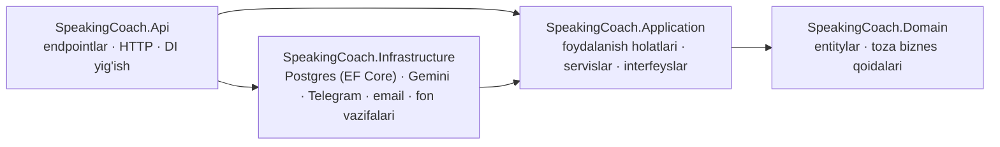

# Backend arxitekturasi (Clean Architecture)

Backend to'rtta loyihadan iborat. Bog'liqliklar faqat **ichkariga** qarab yo'naladi:



| Loyiha | Nima bor | Nimaga bog'liq |
|---|---|---|
| `SpeakingCoach.Domain` | Entitylar (`User`, `Activity`, `ReviewCard`, `Group`…) va toza qoidalar: SM-2 takrorlash jadvali (`ReviewScheduler`), bugungi reja (`PlanLogic`), XP va nishonlar (`ProgressCalculator`), guruh vazifalari (`GroupLogic`), IELTS band jadvali, ravonlik o'lchovlari, xatolar tasnifi | Hech narsaga |
| `SpeakingCoach.Application` | Foydalanish holatlari: baholash (Speaking, Writing, mock), takrorlash, progress, tayyorlik bahosi, kirish (`AuthService`), guruhlar va vazifalar (`GroupService`), hisob ma'lumotlari (`AccountDataService`), O'qish/Tinglash mashqlari (`ComprehensionPractice`), mock imtihonlar (`MockExamService`, `MockGrading`, `MockLimit`), botni saytdan ulash (`TelegramLinkService`), AI limitlari, Telegram bot mantiqi, tayyor kontent. Tashqi dunyo uchun interfeyslar: `IAppDbContext`, `IGeminiClient`, `IEmailSender`, `IGoogleSignIn`, `ITelegramApi`, `IMockRows`, `IPracticeHistory`, `ISchemaInspector`. Servis xatolari HTTP'ni bilmaydi: `Outcome<T>` / `Fail(Key, Status, Args)` qaytadi, Api uni javobga aylantiradi | Domain (+ EF Core yadrosi LINQ uchun — provayder emas) |
| `SpeakingCoach.Infrastructure` | `AppDbContext` va migratsiyalar (Npgsql), `GeminiClient`, Telegram API mijozi, Brevo email, Google kirish, Postgres'ga xos so'rovlar, fon vazifalari (webhook, tozalash, sxema tekshiruvi) | Application |
| `SpeakingCoach.Api` | Minimal API endpointlari, HTTP'ga xos yordamchilar (`request.Error(...)`, sessiya tokenini o'qish, limit javoblari), rate limiting, `Program.cs` (composition root) | Application, Infrastructure |

## Qoidalar

- **Domain** hech qanday paketga (EF, ASP.NET, Npgsql) bog'liq emas.
- **Application** `HttpRequest`/`IResult`ni bilmaydi. HTTP so'rovdan token yoki til olish Api'dagi kengaytma metodlarida (`Web/HttpExtensions.cs`). Endpointlarda chaqiruvlar o'zgarmagan: `auth.GetCurrentUserAsync(request)`.
- **Application** Postgres'ni bilmaydi: provayderga xos SQL (`MockRowsQuery`) va xatolar (`DbErrors.IsUniqueViolation`) Infrastructure'da.
- Har bir qatlam o'z servislarini o'zi ro'yxatdan o'tkazadi: `AddApplication()` va `AddInfrastructure(config)`.
- Yupqa endpoint: faqat HTTP (autentifikatsiya, so'rovni o'qish, `Outcome<T>` → javob). Mantiq va bazaga murojaat Application servisida: `GroupService`, `AccountDataService`, `ComprehensionPractice`, `MockExamService`, `TelegramLinkService`, `PracticeStore`, `FeedbackService`, `ProfileService`, `TalkSessions`. Provayderga xos so'rovlar (jsonb, `ExecuteDelete`) — `IPracticeHistory`/`IMockRows` orqali Infrastructure'da. `ArchitectureTests` HAMMA endpoint sinflarining konkret `AppDbContext`ga tegishini taqiqlaydi (sinflar avtomatik topiladi).
- Qoidalar testlar bilan himoyalangan (`ArchitectureTests`): kimdir qatlam chegarasini buzsa, CI qizil bo'ladi. `Ef_model_matches_the_migrations_snapshot` testi esa model migratsiyalardan farq qilmasligini tekshiradi.

## Keyingi qadamlar (hali qilinmagan)

- `Program.cs` dagi `/health` hamon `AppDbContext`ni to'g'ridan-to'g'ri ishlatadi (composition root, bazaga ulanishni tekshiradi) — alohida tekshiruv interfeysi bilan almashtirish mumkin.
- Funksiya bo'yicha buyruq/so'rov (CQRS) handler'lariga bo'lish va validatsiyani alohida qatlamga ajratish — servislar ko'payganda. Katta servislar (`MockExamService`, `PracticeStore`) o'sib ketsa, mavzu bo'yicha bo'linadi.
- Integratsiya testlari faqat soxta AI va xotiradagi SQLite bilan ishlaydi: Postgres'ga xos so'rovlar (jsonb: `IMockRows`, `IPracticeHistory`) testlarda xotirada qayta yozilgan, shuning uchun ularning haqiqiy SQL'i va migratsiyalar bilan bog'liq xatolar bu testlarda ko'rinmaydi (migratsiya snapshot'i alohida `Ef_model_matches_the_migrations_snapshot` testida). Haqiqiy Postgres bilan (Testcontainers) smoke-test qo'shish mumkin.

## Testlar

- **Birlik testlar** — toza mantiq (Domain/Application qoidalari).
- **Servis testlari** — Application servislari xotiradagi baza (EF InMemory) bilan (`MockExamServiceTests`, `PracticeStoreTests`, ...).
- **HTTP integratsiya testlari** (`Integration/`) — butun ilova `WebApplicationFactory<Program>` bilan: marshrutlar, status kodlari, xato matnlari va tillari, JSON shakllari, CORS, rate limiting, xato xaritasi (502/503/413), Telegram webhook sirlari. Baza — xotiradagi SQLite (`ExecuteUpdate`/`ExecuteDelete` ishlaydi), Gemini va Telegram — soxta (`Integration/Fakes.cs`).

## Buyruqlar

```bash
dotnet test backend/SpeakingCoach.slnx                      # birlik + servis + HTTP integratsiya testlari (Integration/)
dotnet ef migrations add <Nom> --project backend/SpeakingCoach.Infrastructure --startup-project backend/SpeakingCoach.Api
dotnet ef database update --project backend/SpeakingCoach.Infrastructure --startup-project backend/SpeakingCoach.Api
docker build -t speaking-coach-api backend    # Render ham shunday build qiladi (Root Directory: backend)
```
