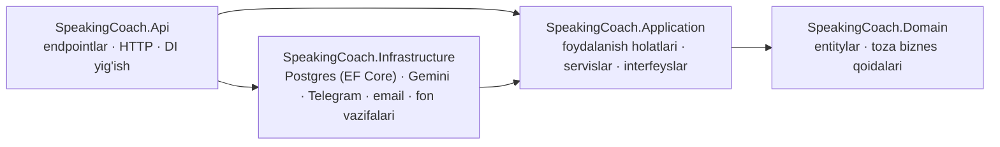

# Backend arxitekturasi (Clean Architecture)

Backend to'rtta loyihadan iborat. Bog'liqliklar faqat **ichkariga** qarab yo'naladi:



| Loyiha | Nima bor | Nimaga bog'liq |
|---|---|---|
| `SpeakingCoach.Domain` | Entitylar (`User`, `Activity`, `ReviewCard`, `Group`…) va toza qoidalar: SM-2 takrorlash jadvali (`ReviewScheduler`), bugungi reja (`PlanLogic`), XP va nishonlar (`ProgressCalculator`), guruh vazifalari (`GroupLogic`), IELTS band jadvali, ravonlik o'lchovlari, xatolar tasnifi | Hech narsaga |
| `SpeakingCoach.Application` | Foydalanish holatlari: baholash (Speaking, Writing, mock), takrorlash, progress, tayyorlik bahosi, kirish (`AuthService`), AI limitlari, Telegram bot mantiqi, tayyor kontent. Tashqi dunyo uchun interfeyslar: `IAppDbContext`, `IGeminiClient`, `IEmailSender`, `IGoogleSignIn`, `ITelegramApi`, `IMockRows`, `ISchemaInspector` | Domain (+ EF Core yadrosi LINQ uchun — provayder emas) |
| `SpeakingCoach.Infrastructure` | `AppDbContext` va migratsiyalar (Npgsql), `GeminiClient`, Telegram API mijozi, Brevo email, Google kirish, Postgres'ga xos so'rovlar, fon vazifalari (webhook, tozalash, sxema tekshiruvi) | Application |
| `SpeakingCoach.Api` | Minimal API endpointlari, HTTP'ga xos yordamchilar (`request.Error(...)`, sessiya tokenini o'qish, limit javoblari), rate limiting, `Program.cs` (composition root) | Application, Infrastructure |

## Qoidalar

- **Domain** hech qanday paketga (EF, ASP.NET, Npgsql) bog'liq emas.
- **Application** `HttpRequest`/`IResult`ni bilmaydi. HTTP so'rovdan token yoki til olish Api'dagi kengaytma metodlarida (`Web/HttpExtensions.cs`). Endpointlarda chaqiruvlar o'zgarmagan: `auth.GetCurrentUserAsync(request)`.
- **Application** Postgres'ni bilmaydi: provayderga xos SQL (`MockRowsQuery`) va xatolar (`DbErrors.IsUniqueViolation`) Infrastructure'da.
- Har bir qatlam o'z servislarini o'zi ro'yxatdan o'tkazadi: `AddApplication()` va `AddInfrastructure(config)`.
- Qoidalar testlar bilan himoyalangan (`ArchitectureTests`): kimdir qatlam chegarasini buzsa, CI qizil bo'ladi. `Ef_model_matches_the_migrations_snapshot` testi esa model migratsiyalardan farq qilmasligini tekshiradi.

## Keyingi qadamlar (hali qilinmagan)

- Ba'zi endpointlarda hamon so'rov mantiqi bor (masalan, `MockEndpoints`, `GroupEndpoints`, `ComprehensionEndpoints`dagi LINQ va xom SQL). Keyingi bosqich: ularni funksiya bo'yicha Application'dagi handler'larga (CQRS: buyruq va so'rov) ko'chirish va validatsiyani alohida qatlamga ajratish.
- Namespace'lar loyihalarga mos: `SpeakingCoach.Domain.Entities`, `SpeakingCoach.Application.Mock`, `SpeakingCoach.Infrastructure.Persistence` va hokazo.

## Buyruqlar

```bash
dotnet test backend/SpeakingCoach.slnx
dotnet ef migrations add <Nom> --project backend/SpeakingCoach.Infrastructure --startup-project backend/SpeakingCoach.Api
dotnet ef database update --project backend/SpeakingCoach.Infrastructure --startup-project backend/SpeakingCoach.Api
docker build -t speaking-coach-api backend    # Render ham shunday build qiladi (Root Directory: backend)
```
